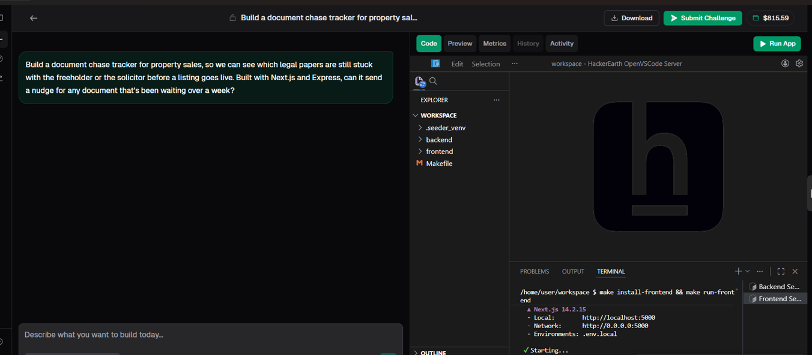
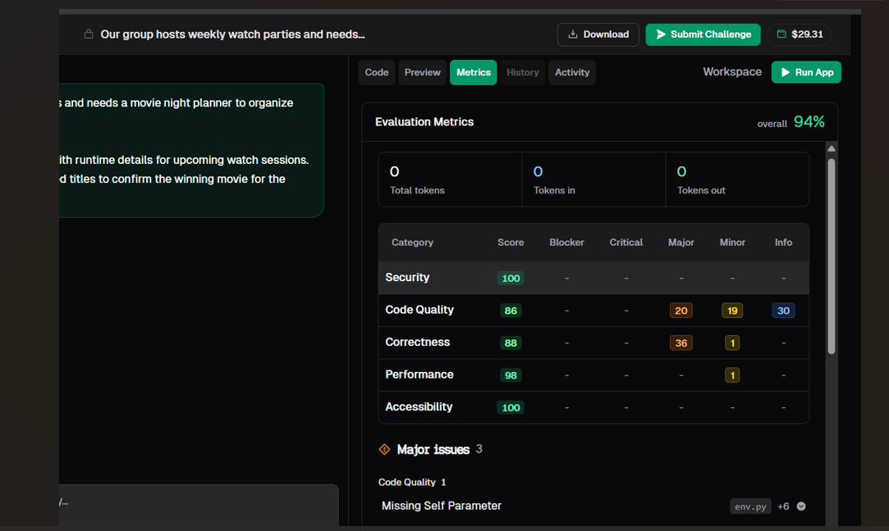
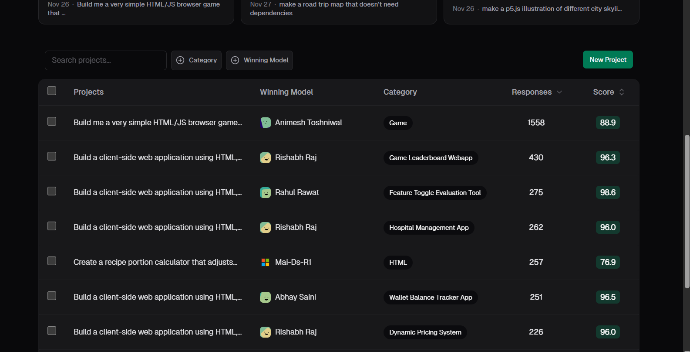
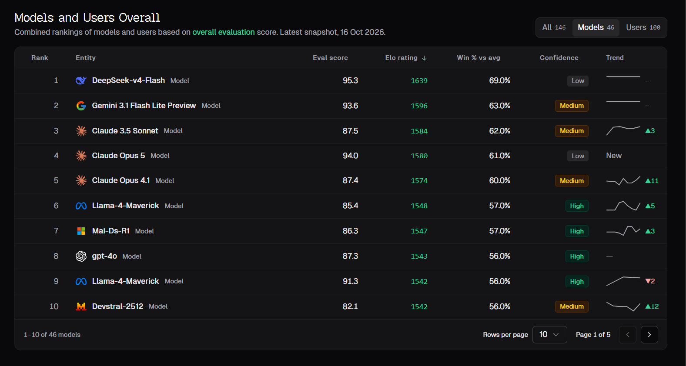

# Reading VibeCodeArena Like an Engineer

**How I used Metrics, History, Activity and the Leaderboard to make better decisions**

*A deep dive into every signal the platform gives you, what each one is good for, where each one misleads, and how I combined them.*

## Contents

- Introduction
- Part 1: The Preview
- Part 2: The Metrics tab
- Part 3: The History tab
- Part 4: The Activity tab
- Part 5: The chat itself
- Part 6: The responses ranking
- Part 7: The global leaderboard
- Part 8: My decision loop
- Common traps I fell into
- Why this matters beyond the platform

---

## Introduction

When you first open a project on VibeCodeArena, it's easy to focus only on the chat. You type a prompt, the AI changes code, you type another prompt. That's the obvious loop.

But after working on the platform as a consultant with HackerEarth, I realised the chat is only half of it. The platform gives you a lot of signals about the app and about the models: a Metrics tab, a History tab, an Activity tab, the Preview, the responses ranking on each project, and a global leaderboard of models and users. Each of these tells you something different. And each of them can also mislead you if you read it alone.

This write-up is about how I learned to read all of these together, kind of like how an engineer reads logs, dashboards and tests together instead of trusting just one. I'll go through each signal, what it's good for, where it fails, and real examples from projects I worked on.

## Part 1: The Preview, the only signal that shows what the user sees

Let's start with the most obvious one, because honestly it's the most important.

The Preview tab runs the actual app. You can switch between desktop, tablet and mobile sizes, set custom width and height, expand it, open it in a new tab or refresh it. When the app has a backend, you click Run App first and then the preview comes up.

**What it's good for:** checking whether the app actually does what the prompt asked. Nothing else on the platform can tell you that as directly.

**Where it fails:** it only shows you what you click on. If you don't test a flow, the preview won't warn you about it. It also doesn't explain why something is broken, just that it is.

**Real example:** on a move-in move-out checklist project, I opened a response that had perfect metrics everywhere. The preview showed "Failed to fetch" on the main page, with no units loading at all. No other signal had flagged that.

**How I use it:** I treat the original prompt as a checklist and click through every requirement in the preview. Then I switch to mobile view, because that's where layouts usually break. And I re-check the main flow after every bigger change.

## Part 2: The Metrics tab, a structured bug list

The Metrics tab evaluates the app in five categories: Security, Code Quality, Correctness, Performance and Accessibility. Each one gets a score, and each one shows a count of issues by severity: Blocker, Critical, Major, Minor and Info. Below that, it lists the major issues with the file they're in. It also shows token usage, total tokens, tokens in and tokens out.

**What it's good for:** finding problems you can't see in the UI. A missing parameter, a code smell, a performance issue, an accessibility gap. It turns "something feels off" into an actual list.

**Where it fails:** the overall percentage can hide a lot, and a perfect score doesn't mean the app works.

**Two real examples that show both sides:**

On a movie night planner, the overall score was 94%. But correctness had 36 major issues and code quality had 20 major, 19 minor and 30 info issues. One major issue was a missing self parameter in a file called `env.py`. A high headline number, hiding real work.

On the checklist app and on an athletic training planner, I saw responses with 100% across every category. Clean. But one couldn't load data at all, and the other was missing a lot of the deeper features its prompt asked for, and its project score was still 50.

**How I use it:** I ignore the big percentage and go straight to the breakdown. Blockers and criticals first, then correctness majors, then code quality majors. When a metric points to a specific file, I write a very scoped prompt, like "fix only that issue in that file, don't change anything else". And I re-check metrics after a few changes to make sure the counts go down, not up.

## Part 3: The History tab, the version control you didn't know you had

This one took me a while to appreciate. The History tab shows every version of the app as a timeline. For each version you can see the prompt that created it, which model made the change, how many files changed, lines added and removed, and the date. And you can open a full diff, in unified or split view, file by file.

**What it's good for:**

- **Understanding what the AI actually did,** instead of trusting its summary
- **Seeing which model made which change.** On one response I looked at, versions were made with gpt-5.4-mini
- **Spotting how big a change was.** One version I saw touched five Vue files in `frontend/src/views`, like `ComparisonPrint.vue`, `ComparisonView.vue`, `InspectionEditor.vue`, `UnitDetail.vue` and `UnitList.vue`, with +29 and -9 lines overall. That's a small, focused change, which is usually a good sign
- **Finding where something broke.** If the app worked at version 4 and broke at version 5, the diff tells you exactly what changed

**Where it fails:** it shows what changed, not whether the change was right. You still need the preview for that.

**How I use it:** after a prompt that touches a lot, I open History and skim the diff. If a "small UI fix" touched backend files, that's a red flag. If a fix is just a couple of lines, I can verify it really quickly.

## Part 4: The Activity tab, what actually ran

The Activity tab shows what happened in the session: the commands that ran, and the model calls, which models were called and which weren't.

**What it's good for:** seeing the process behind a change. If something failed to build or a command errored, this is where you notice it. It's also useful when you're comparing models, because you can see which model actually did the work at each step.

**Where it fails:** it's more of a log than an answer. It tells you what happened, not whether the result is good.

**How I use it:** mostly when something feels off. If the AI says it's done but the app didn't change, Activity helps me see whether it actually ran what it was supposed to.

## Part 5: The chat itself, more signal than you think

Even the chat gives you useful signals if you look closely.

**Time taken.** Under each prompt it shows how long the AI worked, like "Worked for 6m 38s" or "Worked for 58s". On the checklist app, fixing the frontend-backend connection took 6 minutes 38 seconds, adding sample data took 58 seconds, restructuring the checklist took 2 minutes 41 seconds, and building the move-in vs move-out comparison took 4 minutes 41 seconds. Long times usually mean the AI had to dig through a lot, which is a hint to double check the result carefully.

**The model tag.** Each response shows which model answered, like DeepSeek V4 Flash. If you're switching models, this keeps you honest about who did what.

**The summary.** The AI's summary of changes is worth reading every time. On the checklist app, the summary is how I found out it had fixed a missing badge style and a missing import that was causing a 500 error on the comparison API. I didn't ask for either. Without reading the summary, I'd never have known those bugs existed.

## Part 6: The responses ranking on each project

Every project shows All Responses, a ranking of every submitted version with its score and votes.

**What it's good for:** seeing what "good" looks like on that specific project, and learning from other people's approaches. You can open any response and look at its preview, metrics and history.

**Where it fails:** a score is a summary. Two responses close in score can be very different inside. And early on, with few votes, rankings can move.

**Real example:** on the checklist app, my response was at 50 and the next two were at 44.1. When I compared them, the biggest visible difference was simple: mine loaded data and showed the comparison, another one showed "Failed to fetch".

**How I use it:** before starting a challenge, I open the top response and one lower response and compare them in the preview. It quickly shows me what the evaluation seems to reward on that project.

## Part 7: The global leaderboard

Finally, there's the global leaderboard, with tabs for All, Models and Users. Each entry has an eval score, an Elo rating, win percentage against the average, a confidence level (Low, Medium or High) and a trend.

**What it's good for:** getting a feel for how models compare on real tasks, not just benchmarks. In the snapshot I looked at (16 October 2026), DeepSeek-v4-Flash was the top model, followed by Gemini 3.1 Flash Lite Preview and Claude 3.5 Sonnet.

**Where it fails:**

- **Eval score and rank don't always line up.** Claude 3.5 Sonnet, with an eval score of 87.5, ranked above Claude Opus 5 with 94.0. Elo is built from head to head results, so it captures something different from the eval score.
- **Confidence matters.** The top model had Low confidence, meaning not much data behind it yet.
- **It's general, not about your app.** A model that tops the leaderboard might not be the best for your specific stack or task.

**The most interesting thing I saw:** top users had eval scores around 99.5, higher than the top model's 95.3. That makes sense when you think about it. A user's submission is a human guiding an LLM, and that combination beats the model alone.

**How I use it:** as a starting point for which models to try, not as a final answer. Then I judge them on my actual project.

## Part 8: Putting it all together, my decision loop

Here's how all these signals fit into one routine for me:

1. **Read the prompt** and turn it into a requirements checklist
2. **Open the responses ranking** and compare a top and a lower response in the preview
3. **Click Challenge, run the app, test in Preview** against my checklist
4. **Read the Metrics breakdown,** not the headline
5. **Write one focused prompt** for the most important problem
6. **Read the AI's summary,** and note the time it took
7. **Check History** if the change was big or surprising
8. **Check Activity** if the result doesn't match what the AI claims
9. **Re-test in Preview,** including mobile
10. **Repeat,** and only submit when the checklist is done

No single step is fancy. The value comes from not trusting any one signal on its own.

## Part 8.5: Common traps I fell into

Before I had this loop, I made a few mistakes that are worth sharing, because each one came from trusting a single signal.

**Trusting the summary.** The AI would say a bug was fixed, and I'd move on. Then two prompts later I'd find the same bug. Now the summary is just my reading list for what to verify.

**Trusting the headline score.** I once saw a high overall metrics number and assumed the app was nearly done. The breakdown had dozens of major issues.

**Trusting the empty state.** On the checklist app, a friendly "no units yet" message made the app look new and clean, when actually it couldn't reach the backend at all.

**Trusting the leaderboard for my task.** A model ranking high overall doesn't mean it's the best for a Vue and FastAPI project, or for a React and Express one. I still have to judge it on the project in front of me.

Every one of these traps has the same fix: confirm with a second signal.

## Part 9: Why this matters beyond the platform

The more I used VibeCodeArena, the more it felt like normal engineering, just faster.

The Preview is like manual QA. Metrics is like static analysis. History is like version control. Activity is like logs. The leaderboard is like benchmarks. And in real jobs, good engineers don't trust any one of these alone either. They cross-check.

I think that's the most valuable thing I'm taking away. AI can write code incredibly fast, but deciding whether that code is actually right still depends on how well you read the signals around it.

## Closing

If you're new to VibeCodeArena, my one suggestion is this: spend your first hour not prompting, but exploring. Open a few projects, compare responses, read some metrics breakdowns, click through History diffs. Once you understand what each signal tells you, your prompts get way better, because you know exactly what to look for.

And if you've found other ways to read these signals, I'd genuinely love to learn them.
